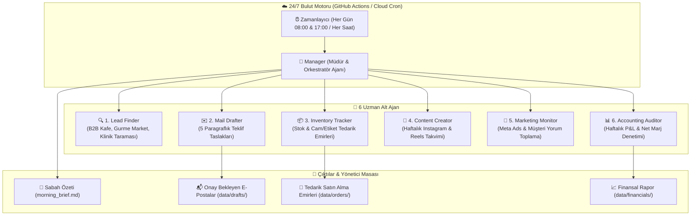

# 🌿 Story of Nature — Otonom Çoklu Ajan Bulut Sistemi (Lindy-Grade AI Team)

Bu sistem; **Story of Nature** (`storyofnature.com.tr`) operasyonlarını yönetmek üzere özel olarak geliştirilmiş, **7 yapay zekâ ajanından** oluşan ve **kullanıcının bilgisayarı kapalıyken dahi bulutta (GitHub Actions / Azure) 7/24 kesintisiz çalışan** otonom bir işletme motorudur.

---

## 🏛️ Mimari ve Ekip Yapısı



---

## ⚡ Hızlı Kullanım (Mac Terminalinden)

Sistemi Mac'inizde dilediğiniz an tek satırla denetleyebilirsiniz:

```bash
cd /Users/emre/.gemini/antigravity/scratch/story-of-nature/site/agent_system

# 1. Tüm ekibi anında çalıştır ve sabah özetini oluştur:
python3 run_agents.py --all

# 2. Sadece stokları ve hazır tedarik emirlerini (PO) gör:
python3 run_agents.py --stock

# 3. Yeni taranan B2B potansiyel müşteri listesini gör:
python3 run_agents.py --leads

# 4. Haftalık sosyal medya içerik ve Reels kanca (hook) planını gör:
python3 run_agents.py --content

# 5. Finansal kârlılık ve P&L tablosunu gör:
python3 run_agents.py --pnl

# 6. Son hazırlanan sabah yönetici özetini ekrana bas:
python3 run_agents.py --brief
```

---

## ☁️ 24/7 Bulut Çalışma Mantığı (Bilgisayar Kapalıyken)

1. Deponun `.github/workflows/story_agents_cloud_runner.yml` dosyası, GitHub'ın bulut sunucularına doğrudan entegredir.
2. Her sabah **TSİ 08:00'de** ve her akşam **TSİ 17:00'de** (ayrıca her an GitHub panelinden tek tıkla) bulut makinesi ayağa kalkar.
3. 6 ajan eş zamanlı olarak çalışır:
   - Yeni B2B müşterileri bulur,
   - Taslak mailleri yazar,
   - Azalan kavanoz veya etiketler için toptan sipariş emirlerini oluşturur,
   - Günün sabah özetini oluşturup depoya işler.
4. Bilgisayarınızı açtığınızda her şey masanızda hazır bekler.
